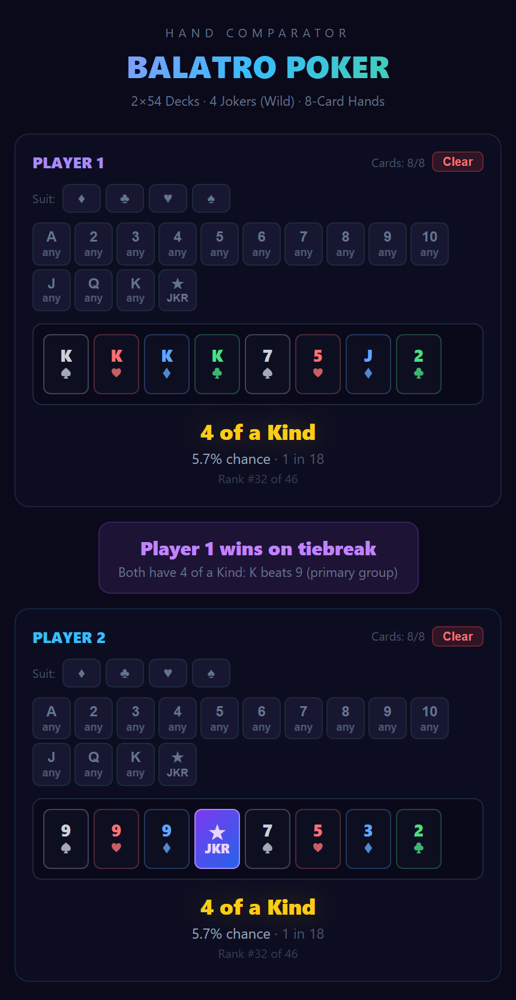

# Balatro Poker

A static web app that settles showdowns in a Balatro-inspired 8-card poker variant: enter two hands, and it names each hand, picks the winner and explains the tiebreak.



## What the app does

- **Compares two hands.** Tap ranks to build two 8-card hands. Each hand is named as the highest-ranked of the 46 hand types it contains, with its probability and rank.
- **Picks the winner.** A higher-ranked type wins. For hands of the same type, an automatic tiebreak runs and the result banner says which card decided it, for example "K beats 9 (primary group)". Identical hands split the pot.
- **Handles jokers.** Each joker becomes whatever card makes the hand strongest, both for naming the hand and for tiebreaks.
- **Makes suits optional.** Cards are entered without a suit by default, which is enough for rank-based hands. Pick a suit when it matters: flushes, straight flushes, rainbows, twins and Full Spectrum.
- **Shows the full ranking.** All 46 hand types, each with its probability and a rarity tier (Legendary, Epic, Rare, Uncommon, Common). Tap a hand to see its description.
- **Works offline.** It is an installable PWA and runs with no connection after the first load.

## The game

- **2 × 54-card decks**: 108 cards in total, including 4 jokers.
- **Up to 4 players**, with 8 cards per hand.
- **Jokers are wild**: each one counts as any card.
- **All 8 cards play**, so compound hands like Two 4 of a Kinds are possible.

### Flow

1. Deal 8 cards to each player.
2. Post the small blind and the big blind.
3. First round of betting.
4. Discard any number of cards and redraw.
5. Second round of betting.
6. Discard and redraw again.
7. Final round of betting.
8. Showdown: play all 8 cards.

## Hand types (46)

### Standard poker hands, extended to 8 cards

- High Card
- One, Two, Three and Four Pairs
- Three of a Kind
- Straight (5 to 8 cards). Ace is high or low (10-J-Q-K-A and A-2-3-4-5). Straights do not wrap from K through A to 2.
- Flush (5 to 8 cards)
- Full House
- Four of a Kind
- Straight Flush (5 to 8 cards)
- Compound hands, for example 4 of a Kind + Trips, Two 4 of a Kinds, and up to 8 of a Kind

### Custom hands

| Hand | Description |
|------|-------------|
| **Rainbow** | A 4-card straight whose 4 cards are 4 different suits (♠♥♦♣) |
| **Double Rainbow** | Two rainbows in one hand that share no rank |
| **Twins** | A pair of identical cards (same rank and same suit). A joker can copy a card. |
| **Double Twins** | Two twin pairs, at any ranks |
| **Triple Twins** | Three twin pairs, at any ranks |
| **Quad Twins** | Four twin pairs: all 8 cards are identical duplicates |
| **Straight Pairs** | 2 to 4 pairs of consecutive ranks (e.g. 7-7 8-8 9-9) |
| **Full Spectrum** | Exactly 2 cards of each suit across all 8 cards |
| **All Evens** | Every card is 2, 4, 6, 8, 10 or Q |
| **All Odds** | Every card is A, 3, 5, 7, 9, J or K |

### Ranking

Rarer hands beat more common ones. A hand counts as the highest-ranked type it contains. For example, 5-5-5-6-6-7-8-9 holds both a Full House and a 5-Card Straight. It counts as a Full House, because Full House ranks higher.

<details>
<summary>Full ranking: chance that a random 8-card deal contains each hand, jokers wild</summary>

| # | Hand | P(contains) | About 1 in | Source |
|---:|---|---:|---:|---|
| 1 | 8 of a Kind | 0.00000183% | 54,704,835 | exact |
| 2 | 8-Card Straight Flush | 0.000142% | 703,736 | exact |
| 3 | 7 of a Kind | 0.000283% | 353,848 | exact |
| 4 | 6 of a Kind + Pair | 0.00141% | 70,983 | exact |
| 5 | Two 4 of a Kinds | 0.00216% | 46,378 | exact |
| 6 | 5 of a Kind + Trips | 0.00258% | 38,693 | exact |
| 7 | 7-Card Straight Flush | 0.00514% | 19,439 | exact |
| 8 | 8-Card Flush | 0.00665% | 15,036 | exact |
| 9 | 6 of a Kind | 0.0158% | 6,319 | exact |
| 10 | 4-Straight Pairs | 0.0191% | 5,226 | exact |
| 11 | Quad Twins | 0.0250% | 4,008 | exact |
| 12 | Double Rainbow | 0.0465% | 2,153 | simulation |
| 13 | 6-Card Straight Flush | 0.0900% | 1,111 | exact |
| 14 | 5 of a Kind + Pair | 0.0961% | 1,040 | exact |
| 15 | 4 of a Kind + Trips | 0.126% | 792 | exact |
| 16 | Two Trips + Pair | 0.147% | 681 | exact |
| 17 | 4 of a Kind + Two Pairs | 0.152% | 659 | exact |
| 18 | 7-Card Flush | 0.187% | 535 | exact |
| 19 | All Evens | 0.214% | 468 | exact |
| 20 | 8-Card Straight | 0.232% | 432 | exact |
| 21 | 5 of a Kind | 0.424% | 236 | exact |
| 22 | All Odds | 0.727% | 138 | exact |
| 23 | Triple Twins | 0.740% | 135 | exact |
| 24 | 5-Card Straight Flush | 0.984% | 102 | exact |
| 25 | Four Pairs | 1.13% | 88.7 | exact |
| 26 | 3-Straight Pairs | 1.65% | 60.5 | exact |
| 27 | 7-Card Straight | 1.65% | 60.5 | exact |
| 28 | Two Trips | 1.98% | 50.6 | exact |
| 29 | 4 of a Kind + Pair | 2.16% | 46.3 | exact |
| 30 | 6-Card Flush | 2.21% | 45.2 | exact |
| 31 | Trips + Two Pairs | 3.16% | 31.7 | exact |
| 32 | 4 of a Kind | 5.69% | 17.6 | exact |
| 33 | 6-Card Straight | 6.58% | 15.2 | exact |
| 34 | Full Spectrum | 8.25% | 12.1 | exact |
| 35 | Double Twins | 8.79% | 11.4 | exact |
| 36 | 5-Card Flush | 14.41% | 6.94 | exact |
| 37 | Three Pairs | 15.59% | 6.41 | exact |
| 38 | Full House | 18.57% | 5.38 | exact |
| 39 | 5-Card Straight | 18.98% | 5.27 | exact |
| 40 | Rainbow | 20.73% | 4.82 | simulation |
| 41 | 2-Straight Pairs | 24.67% | 4.05 | exact |
| 42 | Three of a Kind | 35.99% | 2.78 | exact |
| 43 | Twins | 45.27% | 2.21 | exact |
| 44 | Two Pairs | 58.82% | 1.70 | exact |
| 45 | One Pair | 93.87% | 1.07 | exact |
| 46 | High Card | 100.00% | 1.00 | exact |

</details>

## Tiebreakers

The app breaks ties automatically when both hands have the same type:

1. **Ace is high.** The one exception is the bottom of A-2-3-4-5, where the 5 is the top card.
2. **Groups** (pairs, trips, quads and compound hands): compare the primary group, then the secondary groups, then the kickers from high to low.
3. **Straights, straight flushes, rainbows and straight pairs:** compare the top card, then the kickers.
4. **Flushes:** compare the flush cards from high to low, then the off-suit kickers.
5. **Double Rainbow:** compare the higher rainbow, then the lower one.
6. **Twins:** compare the twin ranks from high to low, then the kickers.
7. **Full Spectrum, All Evens, All Odds and High Card:** compare all 8 cards from high to low.
8. **Jokers** become whichever cards make the hand strongest.
9. **Suits never break ties.** Cards entered without a suit compare by rank.
10. **Perfect tie:** split the pot.

## How it works

### Hand detection

`qualifyFlags()` in `index.html` returns, for each of the 46 types, whether the hand contains it with jokers played optimally. It never tries joker substitutions one by one. Each family of hands has a direct test:

- **Groups (the `canG` check).** Sort the hand's rank counts in descending order. Pair the pattern's group sizes, also largest first (e.g. `[4,2,2]`), with the largest counts. Jokers then fill the shortfall in each group. Giving the biggest group the biggest count is always optimal, so one pass decides patterns like 4 of a Kind + Two Pairs.
- **Straights, straight flushes and straight pairs.** Slide a window over rank positions 0 to 13. Position 0 is a low ace and position 13 is a high ace, so runs never wrap. A window qualifies if its missing cards are no more than the number of jokers.
- **Flushes.** The largest suit count plus the jokers.
- **Twins.** Natural twins, plus one joker for each card held once (the joker copies it), plus one twin for each pair of leftover jokers.
- **Rainbow.** There are 11 four-rank windows, A-2-3-4 through J-Q-K-A. For each window the code tries all 24 orderings of the four suits and counts the missing (rank, suit) cards; a rainbow exists if that count is no more than the jokers. A Double Rainbow needs two windows that share no rank and whose combined missing cards the jokers can cover.

`classify()` then picks the highest-ranked type the hand qualifies for.

### Tiebreaks

`tiebreakKey()` turns a hand into a list of card values (ace = 14) in the order the tiebreak rules compare them. `compareHands()` compares two keys element by element. Joker values are chosen while the key is built: groups search group ranks from high to low, and runs take the highest window the jokers can complete. A joker not needed for the hand plays as an ace, or as a queen in All Evens. A test checks the result against brute force, trying every one of the 52 card faces for each joker.

### How the rankings are derived

A type's rank comes from the probability that a random 8-card deal from the 108-card shoe **contains** it. This uses qualification rather than "best hand", so the ranking does not depend on itself. The rankings are computed offline and hardcoded into `index.html`, between the `RANKINGS` markers; the browser runs no simulation.

- **Exact counts (44 types).** These are counted over all C(108, 8) = 352,025,629,371 possible deals. Most types depend only on a small summary of the hand: its rank counts, suit counts, twin structure, or the set of ranks within each suit. `scripts/exact.mjs` enumerates every summary and builds one representative hand for each. It runs that hand through the same `qualifyFlags()` the app uses and weights the result by how many deals share the summary.
- **Simulation (Rainbow and Double Rainbow).** These two depend on the full rank × suit layout and have no small summary. `scripts/simulate.mjs` deals **200,000,000** hands (seed 1) across `worker_threads`. Double Rainbow appeared 92,909 times and Rainbow 41,464,054 times. Both estimates are more than 140 standard errors from their neighbours in the ranking, so their positions are not in doubt.
- **Rare and unseen types.** No position depends on whether a type turned up in the simulation. The rarest types are placed by exact count; 8 of a Kind, for example, is about 1 in 55 million deals. The simulation also checks the exact counts: every exact type's simulated frequency must fall within 4.5 standard errors of its exact value, or the script refuses to write. The largest deviation in the shipped run was 2.26.

The engine code (between the `ENGINE` markers in `index.html`) is extracted by `scripts/engine.mjs`, so the simulator, the exact counter, the tests and the app all run the same code.

### Offline support

`sw.js` is the only code that caches, and its `VERSION` constant is the app's single version number. The footer gets the version from the worker.

- **Page navigations:** network-first with a 4-second timeout. Online users get the latest `index.html`; offline users get the cached copy.
- **React from the CDN:** cache-first. The URLs pin a version (18.2.0), so a cached file never goes stale.
- **Other same-origin files** (`manifest.json`): stale-while-revalidate.
- **Updates:** bumping `VERSION` installs a new worker, which deletes the old caches when it activates.

### Running the simulation and tests

These use only Node.js built-in modules (tested with Node.js 25), so there is nothing to install.

```bash
node --test
```

```bash
node scripts/simulate.mjs --deals 20000000
```

```bash
node scripts/simulate.mjs --write
```

- `node --test` runs the test suite in `tests/`. It covers a known hand for every type, joker cases, suitless cards, ace-high and ace-low straights, the hardcoded ranking, and tiebreaks.
- The 20-million-deal run is a quick simulation for checking.
- `--write` does the full 200M-deal run and rewrites the `RANKINGS` block in `index.html`. Use `--seed N` and `--workers N` to change the seed or the number of workers.

## Project structure

```
balatro-poker/
├── index.html          # The whole app: engine, generated rankings, React UI
├── manifest.json       # PWA manifest
├── sw.js               # Service worker (offline caching, app version)
├── scripts/
│   ├── engine.mjs      # Loads the engine and rankings out of index.html for Node
│   ├── exact.mjs       # Exact qualification counts over all C(108, 8) deals
│   └── simulate.mjs    # Multi-threaded simulation; writes the RANKINGS block
├── tests/              # node --test suites (classification, rankings, tiebreaks)
├── docs/
│   └── screenshot.png
└── README.md
```

## Setup

There is no build step: the app is just static files. To run it locally, serve the folder with any static file server. Opening `index.html` straight from disk also works, but offline caching needs the page served over http(s).

### Deploy

Drag the folder onto [app.netlify.com/drop](https://app.netlify.com/drop) and you get a live URL. Any other static host works too.

### Install on a phone

- **iPhone:** Safari → Share → "Add to Home Screen"
- **Android:** Chrome → Menu → "Install app"

After the first load, the app works fully offline.

## Tech

- React 18 UMD from CDN using React.createElement (no JSX, no build step)
- Plain JavaScript in a single `index.html`; no backend and no runtime dependencies
- A service worker for offline use and updates
- Node.js scripts, built-in modules only, for the offline ranking computation and the tests
